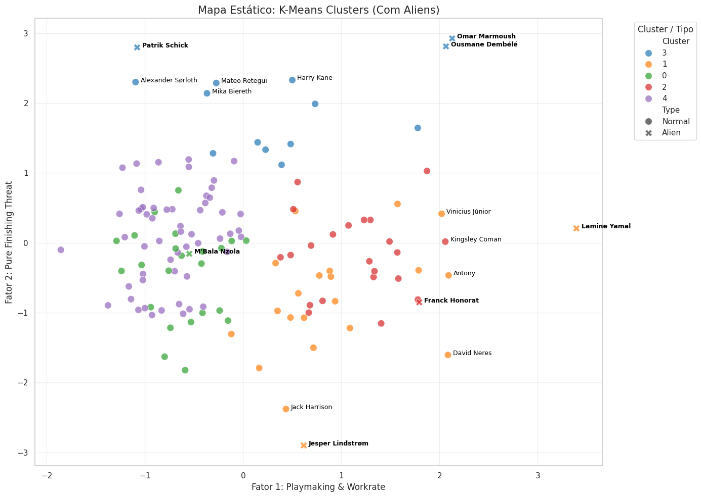
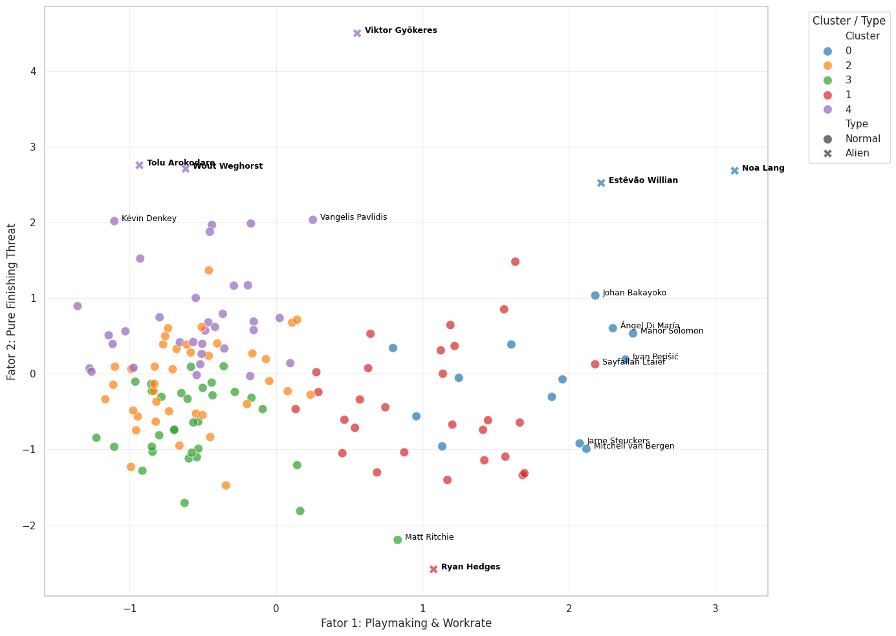

# Hidden Bargains: Finding Undervalued Forwards

**Which forwards outperform their peers but are still priced below players with a similar profile?**

A group project for the Data Analysis course at NOVA IMS (December 2025). Using 2024/25 performance data from FBref and market values from Transfermarkt, we reduced 17 performance metrics to three playing dimensions with Principal Component Factoring, grouped forwards into five profiles with cluster analysis, and then compared each player's market value with the median of his own profile to find "hidden bargains".

The analysis runs separately for two groups of leagues, so stats from weaker leagues are not compared directly with the Big 5:

* **Big 5:** Premier League, LaLiga, Serie A, Bundesliga, Ligue 1 (138 forwards)
* **Secondary leagues:** Liga Portugal, Eredivisie, Belgian Pro League, Brasileirão, EFL Championship (150 forwards)

Only forwards who played at least 35% of available minutes were included. The split between the two groups follows the Opta Power Rankings.



---

## Key findings

### Three dimensions describe a forward

| Factor | What loads on it | Profile |
|-|-|-|
| **F1 – Playmaking & Work Rate** | Passes into the box, shot- and goal-creating actions, progressive carries, touches in the final third, tackles + interceptions | Winger |
| **F2 – Pure Finishing Threat** | Goals, shots, goals per shot, touches in the box | Striker |
| **F3 – Error Proneness** | Miscontrols, dispossessions | Ball security (lower is better) |

### Five profiles in each group of leagues

| Big 5 | Secondary leagues |
|-|-|
| Inefficient Possession Players | Elite Safe Playmakers |
| High-Risk Creators | High-Risk Creators |
| Elite Safe Playmakers | Inefficient / Volatile Forwards |
| Complete Goalscorers (e.g. Kane, Mbappé) | Conservative / Low-Impact |
| Conservative / Low-Volume Forwards | Clinical Poachers |

* **The Big 5 has depth at the top.** It has a whole cluster of elite finishers. In the secondary leagues there is no equivalent group: once the outliers are removed, the best strikers are good but not elite. Talent there is concentrated in a few exceptional players.
* **The model isolates the elite on its own.** The outlier step flagged Ousmane Dembélé and Lamine Yamal (first and second in the 2025 Ballon d'Or) and Viktor Gyökeres, who sits more than four standard deviations above the mean on Finishing Threat. Most of the secondary-league outliers (Gyökeres, Estêvão, Noa Lang, Arokodare) made big-money moves that summer.

### Hidden bargains

A player had to score above the elite threshold of his own cluster (for example, a Safe Playmaker needed Playmaking > 1.0 and Error Proneness < −1.0) and be priced at or below the cluster's median market value. The median is used because players like Haaland or Mbappé would inflate the mean.

**Big 5**

| Player | Age | Profile | Market value | Cluster median |
|-|-|-|-|-|
| Franck Honorat* | 28 | Elite Safe Playmaker | €12M | €25M |
| Georges Mikautadze | 23 | Complete Goalscorer | €22M | €45M |
| Mika Biereth | 22 | Complete Goalscorer | €30M | €45M |
| Patrik Schick* | 29 | Complete Goalscorer | €27M | €45M |
| Antony | 25 | High-Risk Creator | €35M | €35M |

**Secondary leagues**

| Player | Age | Profile | Market value | Cluster median |
|-|-|-|-|-|
| Mohamed Nassoh | 23 | High-Risk Creator | €0.7M | €4M |
| Mitchell van Bergen | 26 | Elite Safe Playmaker | €1.5M | €3M |
| Sayfallah Ltaief | 25 | High-Risk Creator | €1.8M | €4M |
| Wout Weghorst* | 32 | Clinical Poacher | €4M | €11M |
| Promise David | 24 | Clinical Poacher | €11M | €11M |

\* Outlier ("Alien") re-assigned to its nearest cluster after the clustering. Market values from Transfermarkt at the time of the analysis.



---

## Method

1. **Data:** FBref per-90 performance stats and Transfermarkt market values, merged and cleaned in SAS (names, duplicates, player IDs, position and minutes filters). No missing values.
2. **Variables:** 17 metrics covering scoring, shot volume and quality, chance creation, involvement in the final third, ball progression, defensive work and technical errors. All standardised.
3. **Principal Component Factoring:** KMO of 0.81 (Big 5) and 0.73 (secondary). Kaiser, cumulative variance and the scree plot pointed to 3 or 4 factors. The 4th factor only loaded on G−xG, so 3 were kept, explaining 65% (Big 5) and 62% (secondary) of the variance. Varimax rotation. RMSR of 0.087 and 0.094.
4. **Outliers:** players beyond 1.5×IQR on any factor score were set aside (7 in the Big 5, 6 in the secondary leagues), split into positive outliers ("Aliens") and negative ones.
5. **Clustering:** hierarchical clustering with Ward's linkage (the best R² of five linkage methods). The R² curve and the dendrogram both pointed to 5 clusters. The hierarchical centroids were used as seeds for K-Means. Final R² of 0.615 (Big 5) and 0.629 (secondary).
6. **Outlier re-assignment:** the outliers were assigned to the nearest K-Means centroid.
7. **Moneyball filter (SAS):** cluster-specific performance thresholds, market value compared with the cluster median, and age bands (≤23 development, 24–29 prime, ≥30 veteran).

---

## Retrospective: what I would change

**The outliers were detected at the wrong moment.** In the notebooks, outliers are flagged on the factor scores, which means after the standardisation and the factor model had already been fitted on all players. They were then removed before K-Means and assigned to a cluster afterwards.

Removing them before K-Means was the right call, because K-Means centroids are very sensitive to extreme points. Detecting them only after the factor analysis was not. The means and standard deviations, the correlation matrix, and therefore the loadings and every player's factor scores were all estimated with the 13 most extreme players included. Correlations are sensitive to extreme values, so the "Aliens" helped shape the same dimensions they were later judged on. The rule was also applied one factor at a time rather than on the full profile, which does not quite match our own argument that a player should be judged as a whole.

What I would do now:

1. Detect multivariate outliers on the standardised raw variables, **before** the factor analysis (Mahalanobis distance, ideally a robust version such as MCD, with a chi-square cut-off).
2. Fit the scaler and the factor model on the remaining players only.
3. Project the outliers onto that solution with the same scaler and loadings, so they still get factor scores and can be analysed.
4. Cluster the core group and assign the outliers to the nearest centroid, as before.
5. Compare loadings, clusters and the final picks with the original run.

I have not re-run the analysis with this order yet, so I cannot say whether the bargain picks would change.

---

## Limitations

* **Output, not role.** The model sees what a player did, not what he was asked to do. A striker told to stay central looks like a poor playmaker.
* **No intangibles.** Off-ball movement, decision-making and adaptability are not captured by event data.
* **The 35% minutes filter** removes injured players and mid-season signings, some of whom may be the real bargains.
* **Market value is simplified.** Contract length, commercial appeal and the selling club's finances also drive price. A "bargain" may just be a player with an expiring contract.
* **Position labels.** Only players listed as forwards on FBref were included, so hybrid profiles listed as midfielders (e.g. Wirtz, Palmer) are missing.
* **Context matters.** Omar Marmoush was the most complete player in the Big 5 sample while at Frankfurt, but his high Error Proneness was less tolerated after his move to Manchester City. The model measures past output, not how a player will adapt.

---

## Repository

```
hidden-bargains/
├── notebooks/
│   ├── big5_analysis.ipynb                 # PCF, outliers, clustering (Big 5)
│   └── secondary_leagues_analysis.ipynb    # same pipeline (secondary leagues)
├── docs/
│   ├── Hidden_Bargains_Report.pdf          # full report
│   └── Hidden_Bargains_Presentation.pdf
├── images/
└── data/                                   # not included (see below)
```

**Data:** the FBref and Transfermarkt datasets are not included. The notebooks expect `Hidden Gems Group Big5.xlsx` (sheet `Dataset`) and `LOW5.xlsx` (sheet `Sheet1`), with one row per player and the player name as index. The SAS merge and Moneyball steps are described in the report.

**Python libraries:** pandas, numpy, scikit-learn, factor_analyzer, pingouin, feature-engine, scipy, matplotlib, seaborn, plotly.

---

**Authors:** Afonso Marques, David Afonso, Guilherme Valido, Martim Coelho, Miguel Marto — Information Management, NOVA IMS.

**My contribution:** I worked on every stage of the project (data collection and merging, factor analysis, outlier analysis, clustering, the Moneyball framework and the report), except the SAS visualisations, which were done by David Afonso.
